<div align="center">


# ALL Launcher

**เล่น Minecraft: Java Edition บนมือถือ Android ด้วยหน้าตาแบบเดสก์ท็อป**

[](https://github.com/TheBouy3224/ALL-Launcher/releases/latest)

[](LICENSE)

ภาษาไทย · [English](README_EN_US.md) · [繁體中文](README_ZH_TW.md)

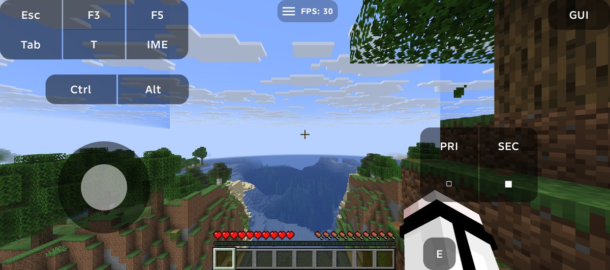

</div>

> [!IMPORTANT]
> ALL Launcher เป็น **Unofficial Modified Version** (ฉบับดัดแปลงที่ไม่เป็นทางการ) ของ [Zalith Launcher 2](https://github.com/ZalithLauncher/ZalithLauncher2) โดย MovTery และผู้ร่วมพัฒนา
> ไม่ได้จัดทำหรือรับรองโดยผู้พัฒนา Zalith Launcher, Mojang หรือ Microsoft

## ALL Launcher คืออะไร

ALL Launcher คือแอป Android สำหรับเปิดเกม **Minecraft: Java Edition** (ตัวเดียวกับบน PC) บนมือถือ หน้าตาเป็นเดสก์ท็อปแบบคอมพิวเตอร์ (**ALL Desktop**): แต่ละเวอร์ชันของเกมเป็นไอคอนบนเดสก์ท็อป เปิดเป็นหน้าต่าง มีแถบงานและปุ่ม Start

ติดตั้งเกมได้ทั้ง Vanilla, Fabric, Quilt, NeoForge และ Forge ดาวน์โหลดม็อด ม็อดแพ็ก รีซอร์สแพ็ก เชดเดอร์แพ็ก และโลกได้จากในแอป และมี **Mod Doctor** ช่วยตรวจม็อดที่ติดตั้งไว้

## จุดเด่น

| | |
|---|---|
| 🎮 **เล่น Java Edition บนมือถือ** | ทดสอบกับ Minecraft 26.3, 1.21.11 และ 1.20.1 บนมือถือจริง (TECNO และ iQOO) |
| 🔄 **อัปเดตทับแล้วข้อมูลไม่หาย** | ติดตั้ง 1.0.0 ทับ Beta 3 ได้เลย บัญชี เกม ม็อด โลก และการตั้งค่ายังอยู่ครบ |
| 🧩 **ทุก loader** | Vanilla · Fabric · Quilt · NeoForge · Forge (OptiFine เมื่อเวอร์ชันนั้นรองรับ) |
| ⚡ **เล่นม็อดแพ็กที่มี Sodium ได้** | `ALLCompatAgent` (ตัวช่วยของ ALL เอง) ทำให้ Sodium ไม่ปิดเกมเมื่อรันบน Android |
| 📦 **ไฟล์เสริมโหลดเมื่อต้องใช้** | `MioLibPatcher`, `forge_installer`, `nide8auth` ไม่ได้ฝังใน APK แอปโหลดจากผู้เผยแพร่ตอนใช้ครั้งแรก |
| 🖼️ **หน้าตาใหม่** | หน้าติดตั้งเกมแบบมินิมอล หน้าเชดเดอร์แพ็กรูปเต็ม โลโก้ ALL ทุกจุด |
| 🗂️ **ใช้ของเดิมต่อได้** | instance, ม็อด และโลกจากรุ่นก่อนเปิดเล่นต่อได้ทันที |

## ภาพตัวอย่าง

| เดสก์ท็อปและ instance | กดเริ่มเกม |
|---|---|
| 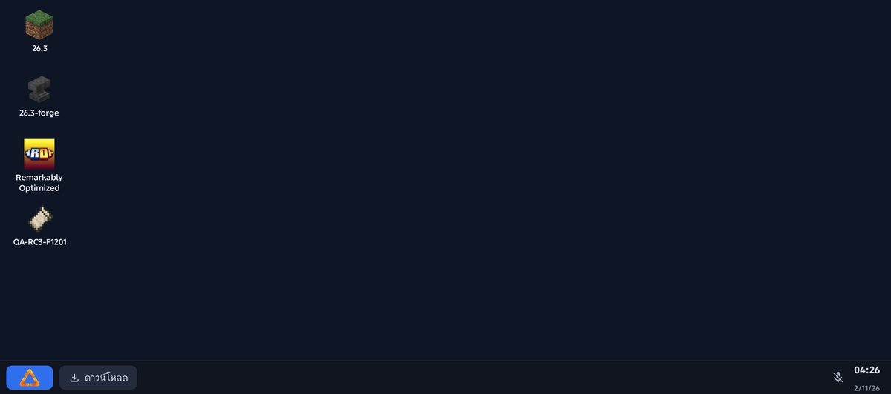 | 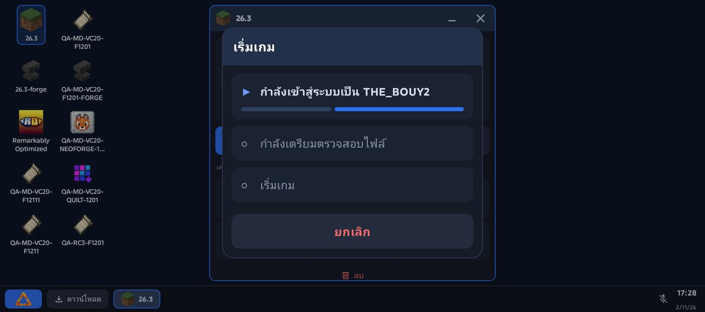 |
| **ติดตั้งเกม (Vanilla)** | **ติดตั้งเกม (Fabric + เลือกเวอร์ชัน)** |
| 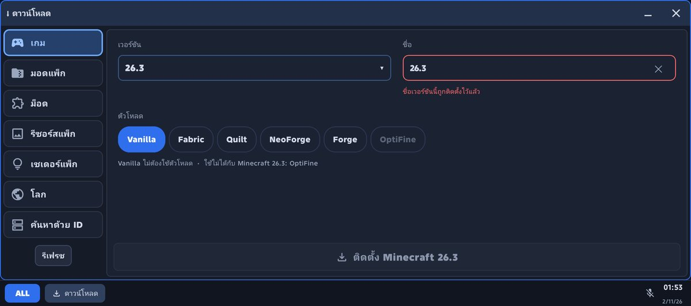 | 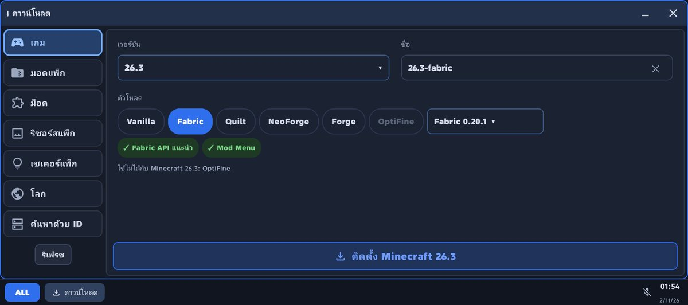 |
| **ดาวน์โหลดเชดเดอร์แพ็ก** | **หน้าเข้าสู่ระบบ** |
| 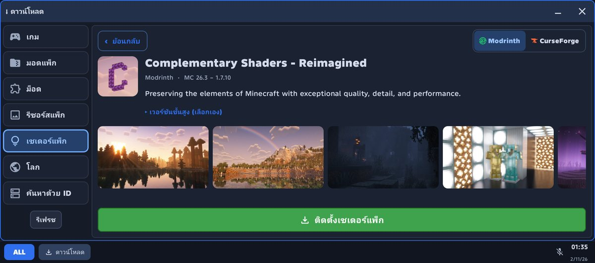 | 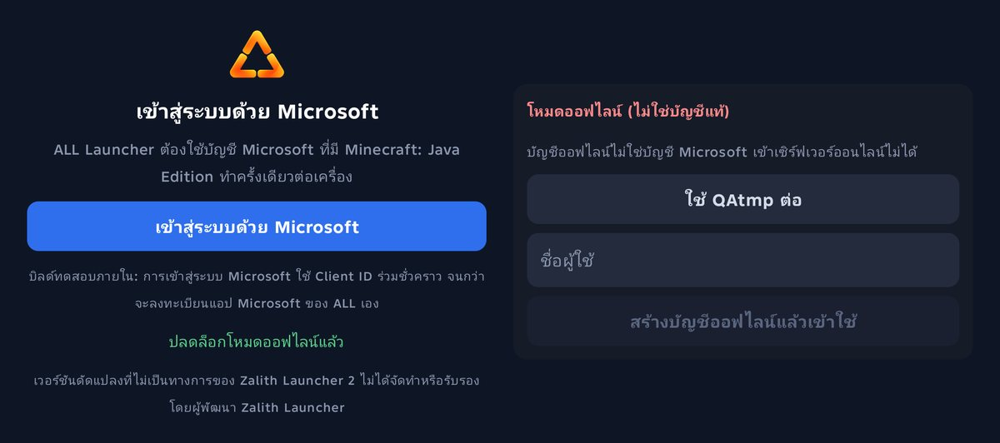 |
| **เมนูในเกม** | **ม็อดแพ็ก Remarkably Optimized (137 ม็อด)** |
| 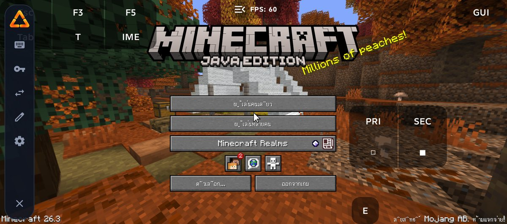 | 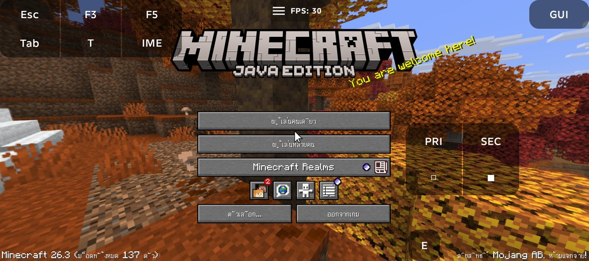 |
| **ในเกมจริง (Fabric 1.21.11 + ม็อด)** | **หน้าเกี่ยวกับ** |
| 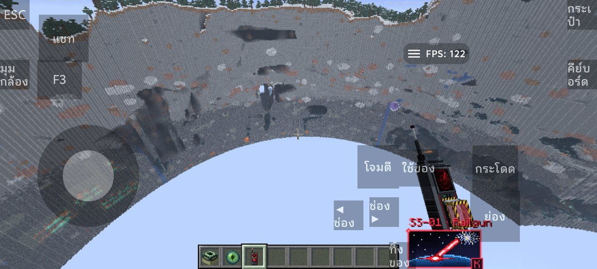 | 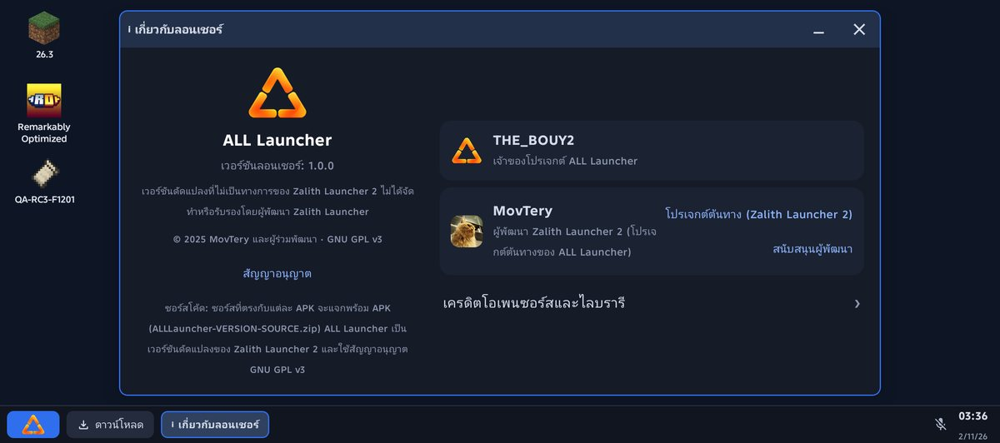 |

## มีอะไรในแอป

- **บัญชี**: Microsoft (บัญชี Minecraft ที่ซื้อแล้ว) และบัญชีออฟไลน์ (ซ่อนไว้เป็นค่าเริ่มต้น) บัญชี authlib-injector และ Nide8 ใช้ได้จากโหมด Classic
- **Instance**: แต่ละเวอร์ชันมีโฟลเดอร์ ม็อด โลก และการตั้งค่าของตัวเอง เปิดจากไอคอนบนเดสก์ท็อป และจัดการม็อด รีซอร์สแพ็ก เชดเดอร์แพ็ก ภาพหน้าจอ เซิร์ฟเวอร์ และเซฟได้จากหน้าต่าง instance
- **ดาวน์โหลด**: เกม · ม็อด · ม็อดแพ็ก · รีซอร์สแพ็ก · เชดเดอร์แพ็ก · โลก จาก Modrinth และ CurseForge
- **Renderer และ Java**: MobileGlues (เลือกให้อัตโนมัติสำหรับ Minecraft 1.17 ขึ้นไป รวม 26.x), GL4ES / NG-GL4ES, Kopper Zink, Freedreno, Panfrost, VirGL ตามที่เครื่องรองรับ และมี Java 8 / 17 / 21 / 25 ในตัว
- **Mod Doctor**: ตรวจม็อด Fabric/Quilt ที่ติดตั้งไว้ และเสนอวิธีแก้ที่ดูตัวอย่างก่อนและย้อนกลับได้ ตั้งให้ตรวจทุกครั้งที่เริ่มเกมได้
- **ปุ่มควบคุม**: ปุ่มบนจอ, Controls Studio สำหรับจัดปุ่มเอง, รองรับจอยเกมและไจโร

## มาจากไหน

ALL Launcher พัฒนาต่อจาก **[Zalith Launcher 2](https://github.com/ZalithLauncher/ZalithLauncher2)** (GPL-3.0) ซึ่งใช้ [PojavLauncher](https://github.com/PojavLauncherTeam/PojavLauncher) เป็นแกนเปิดเกม สิ่งที่ ALL ทำเพิ่มคือหน้าตา ALL Desktop, ขั้นตอนบัญชีและการติดตั้งแบบใหม่, Mod Doctor, `ALLCompatAgent`, การโหลดไฟล์เสริมเมื่อต้องใช้ และภาษาไทย

ตามข้อกำหนดของ Zalith Launcher 2 แอปนี้ใช้ชื่อของตัวเอง แสดงข้อความ "Unofficial Modified Version" ที่หน้าเริ่มต้น เมนู Start และหน้าเกี่ยวกับ และคง copyright เดิมไว้ ปัญหาของ ALL Launcher ให้แจ้งที่ [Issues ของ repo นี้](https://github.com/TheBouy3224/ALL-Launcher/issues) ไม่ใช่ที่ Zalith

## ดาวน์โหลด

**[➡️ ALL Launcher 1.0.0 (Release ล่าสุด)](https://github.com/TheBouy3224/ALL-Launcher/releases/latest)**

| ไฟล์ | ใช้ทำอะไร |
|---|---|
| `ALLLauncher-1.0.0-arm64-v8a.apk` | **ไฟล์ที่ต้องโหลด** ติดตั้งบนมือถือ |
| `ALLLauncher-1.0.0-SOURCE.zip` | ซอร์สทั้งหมดของ APK นี้ (GPL-3.0) |
| `ALLLauncher-1.0.0-OPENJDK-SOURCES.zip` | ซอร์ส OpenJDK ของ Java ที่แถมในแอป |
| `SHA256SUMS.txt` | ค่า SHA-256 ไว้ตรวจว่าไฟล์ไม่เสีย |

วิธีติดตั้ง: โหลด APK → เปิดไฟล์ → อนุญาตการติดตั้งจากแหล่งที่ไม่รู้จัก (แอปนี้ไม่ได้อยู่ใน Play Store) → ติดตั้ง ถ้ามีรุ่นเก่าอยู่แล้วติดตั้งทับได้เลย

## สถานะปัจจุบัน

- เวอร์ชัน **1.0.0** (versionCode 21) · แพ็กเกจ `com.all.launcher.app`
- Android 8.0 ขึ้นไป (API 26+) · **ARM64 เท่านั้น**
- Unofficial Modified Version ของ Zalith Launcher 2 · เจ้าของโปรเจกต์: THE_BOUY2

## ข้อควรรู้

- **Microsoft Login** ยังใช้ Client ID สำรองชั่วคราว ตอนนี้ใช้ได้ปกติ แต่ Microsoft อาจปิดได้ในอนาคต (รายละเอียด: [`PUBLIC-RELEASE-REQUIREMENTS.md`](PUBLIC-RELEASE-REQUIREMENTS.md))
- ไฟล์เสริมบางตัวโหลดตอนเปิดเกมครั้งแรก ควรต่ออินเทอร์เน็ตตอนเล่นครั้งแรก
- ในเมนูเกม ถ้าแตะแล้วปุ่มไม่ทำงาน ให้เลื่อนเคอร์เซอร์เข้ากลางปุ่มก่อน
- ปัญหาที่รู้แล้วทั้งหมด: [`KNOWN_ISSUES.md`](KNOWN_ISSUES.md)

## ความเป็นส่วนตัว

ไม่มีระบบเก็บสถิติหรือส่งรายงาน crash ปิดการสำรองข้อมูลของ Android สำหรับแอปนี้ token และรหัสผ่านของบัญชีเข้ารหัสด้วยคีย์ใน Android Keystore (AES-256-GCM) log ของเกมซ่อน access token ไว้ แต่ยังมีชื่อผู้เล่น path และรายชื่อม็อด แอปติดต่อ Mojang/Microsoft (login), Modrinth/CurseForge (ม็อด), Mojang/Fabric/Quilt/NeoForged/MinecraftForge (ไฟล์เกม) และ mclo.gs เฉพาะตอนที่กดแชร์ log

## Build และซอร์สโค้ด

- วิธี build บน Linux: [`BUILDING-UBUNTU.md`](BUILDING-UBUNTU.md) — JDK 25, Android SDK 37 (minor 2), NDK 25.2.9519653, Gradle 9.5.0
- ทุก APK มาพร้อมซอร์สที่ตรงกับตัวนั้น (`ALLLauncher-<version>-SOURCE.zip`) ถ้าได้ APK มาโดยไม่มีซอร์ส ขอได้จากคนที่ส่งให้
- ที่มาของส่วนประกอบภายนอก: [`THIRD-PARTY-SOURCES.md`](THIRD-PARTY-SOURCES.md) · [`NOTICE.md`](NOTICE.md) · [`SOURCE-README.md`](SOURCE-README.md)

```bash
git clone https://github.com/TheBouy3224/ALL-Launcher.git
cd ALL-Launcher
./gradlew :ZalithLauncher:assembleDebug -Darch=arm64      # debug APK (com.all.launcher.app.debug)
./gradlew :ZalithLauncher:testDebugUnitTest               # unit tests
```

ค่าเสริม (ไม่อยู่ใน repo):
- **CurseForge**: ไม่มี API key แถมมา ถ้าไม่ใส่จะใช้ mirror MCIM (Modrinth ใช้ได้ปกติ) ใส่ key เองได้ที่ `CURSEFORGE_API_KEY` หรือ `.curseforge_api.txt`
- **Microsoft client ID**: `OAUTH_CLIENT_ID` หรือ `.oauth_client_id.txt`
- **Release signing**: `ALL_STORE_PASSWORD` / `ALL_KEY_PASSWORD` และ keystore ใน `private-signing/` (ไม่เคย commit) APK ที่เซ็นด้วยคีย์อื่นติดตั้งทับ ALL Launcher เดิมไม่ได้

## License และเครดิต

ALL Launcher ใช้สัญญาอนุญาต **[GNU GPL-3.0](LICENSE)** เช่นเดียวกับ Zalith Launcher 2 และอยู่ภายใต้ข้อกำหนดเพิ่มเติมของ Zalith Launcher 2 (GPLv3 ข้อ 7: ห้ามใช้ชื่อ "ZalithLauncher"/"ZL", ต้องแสดง "Unofficial Modified Version", ห้ามลบ copyright) ข้อความเต็มและตารางไลบรารีโอเพนซอร์สอยู่ใน [README_EN_US.md](README_EN_US.md#-license) และในแอป (เกี่ยวกับ → เครดิตและไลบรารี)

ขอบคุณ **MovTery และผู้ร่วมพัฒนา Zalith Launcher 2**, ทีม **PojavLauncher**, **FCL**, **MobileGlues** และทุกโครงการโอเพนซอร์สที่ระบุใน [`NOTICE.md`](NOTICE.md)
