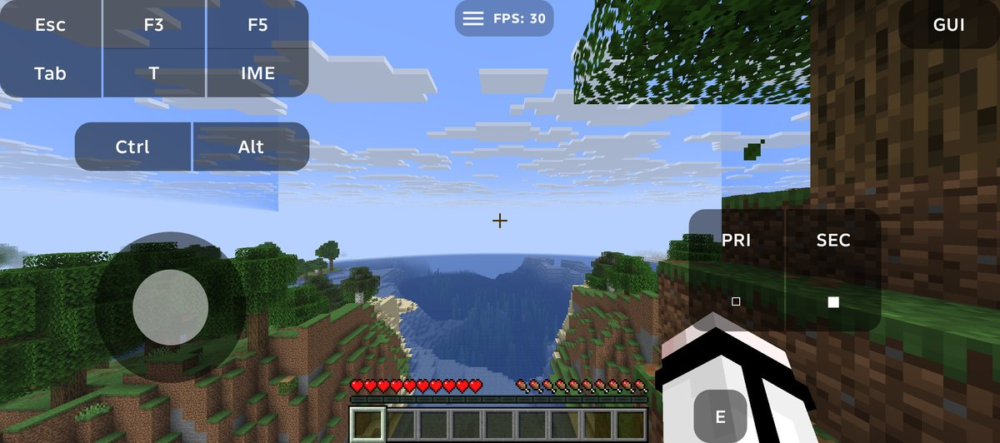
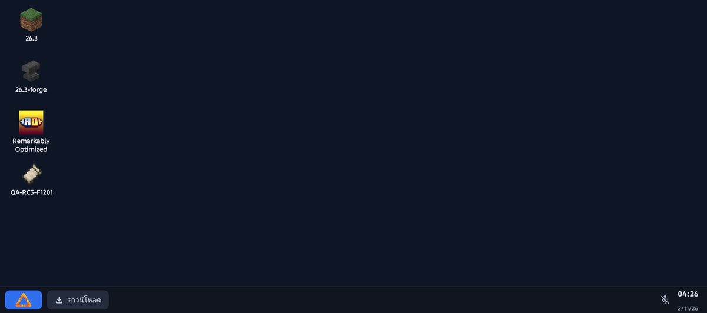
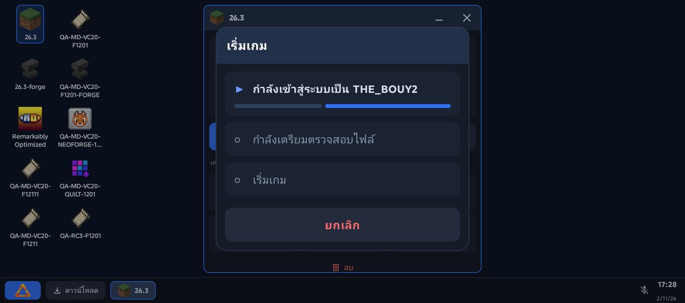
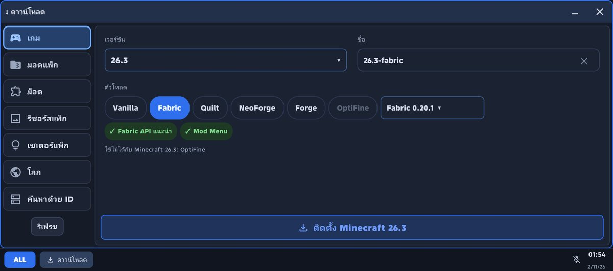
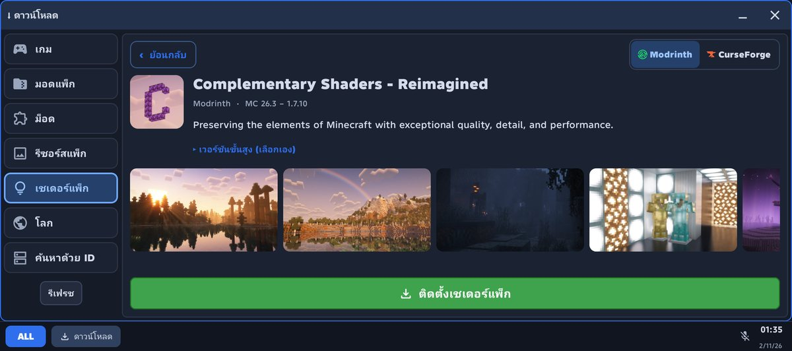
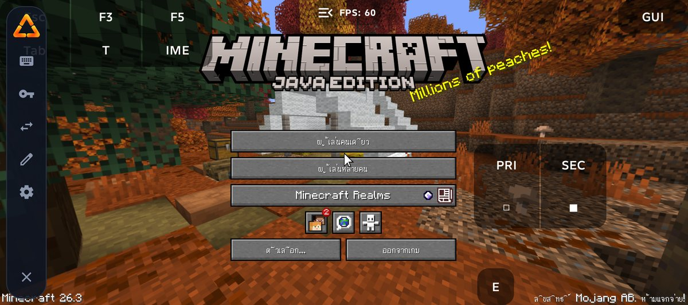
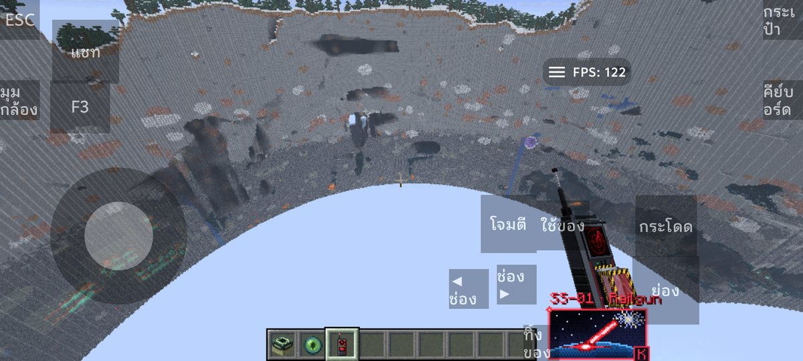

<div align="center">


# ALL Launcher

**Minecraft: Java Edition on Android, with a desktop-style launcher**

[ภาษาไทย](README.md) · English · [繁體中文](README_ZH_TW.md)



</div>

> [!IMPORTANT]
> ALL Launcher is an **Unofficial Modified Version** of [Zalith Launcher 2](https://github.com/ZalithLauncher/ZalithLauncher2) by MovTery and contributors. It is not made or endorsed by the Zalith Launcher developers, Mojang or Microsoft.

## What it is

An Android app that runs **Minecraft: Java Edition** on phones, with a desktop-style interface (**ALL Desktop**: each game instance is an icon, opens in a window, with a taskbar and Start menu). It installs Vanilla, Fabric, Quilt, NeoForge and Forge, downloads mods, modpacks, resource packs, shader packs and worlds, and checks installed mods with **Mod Doctor**. Like Zalith Launcher 2 it uses [PojavLauncher](https://github.com/PojavLauncherTeam/PojavLauncher) as its launching engine.

## Highlights (1.0.0)

- Tested with Minecraft 26.3, 1.21.11 and 1.20.1 on real phones (TECNO, iQOO)
- Updates over Beta 3 keep accounts, instances, mods, worlds and settings
- `ALLCompatAgent` (ALL's own GPL agent) lets Sodium-based modpacks start on Android
- `MioLibPatcher`, `forge_installer` and `nide8auth` are not bundled; they are downloaded from their publishers on first use
- Minimal game-install page, full-size shader-pack previews, ALL logo throughout
- Accounts: Microsoft and offline (hidden by default); authlib-injector and Nide8 in Classic mode
- Renderers: MobileGlues (automatic for 1.17+), GL4ES / NG-GL4ES, Kopper Zink, Freedreno, Panfrost, VirGL; Java 8 / 17 / 21 / 25 bundled

## Screenshots

| | |
|---|---|
|  |  |
|  |  |
|  |  |

## Download

[**Latest release (1.0.0)**](https://github.com/TheBouy3224/ALL-Launcher/releases/latest): `ALLLauncher-1.0.0-arm64-v8a.apk` (install this), `ALLLauncher-1.0.0-SOURCE.zip` (complete source), `ALLLauncher-1.0.0-OPENJDK-SOURCES.zip` (OpenJDK sources of the bundled runtimes), `SHA256SUMS.txt`.

Android 8.0+ (API 26+), **ARM64 only**. Package `com.all.launcher.app`, versionCode 21.

## Good to know

- Microsoft sign-in currently uses a temporary fallback client id; it works but Microsoft may block it ([details](PUBLIC-RELEASE-REQUIREMENTS.md)).
- Some helper files download on the first game start; be online the first time.
- Full list: [`KNOWN_ISSUES.md`](KNOWN_ISSUES.md).

## Building

JDK 25 (21+ works; 17 crashes the release lint task), Android SDK 37 minor 2, NDK 25.2.9519653, Gradle 9.5.0 wrapper.

```bash
git clone https://github.com/TheBouy3224/ALL-Launcher.git
cd ALL-Launcher
./gradlew :ZalithLauncher:assembleDebug -Darch=arm64
```

Linux setup: [`BUILDING-UBUNTU.md`](BUILDING-UBUNTU.md). Release signing material is not in this repository.

## Upstream

ALL Launcher is based on Zalith Launcher 2 ([repository](https://github.com/ZalithLauncher/ZalithLauncher2), [Weblate](https://hosted.weblate.org/projects/zalithlauncher2), [sponsor MovTery](https://afdian.com/a/MovTery)). Report ALL Launcher problems to [this repository](https://github.com/TheBouy3224/ALL-Launcher/issues), not to the Zalith Launcher developers. The licence terms and library list below are kept from Zalith Launcher 2.

## 📜 License

This project is licensed under the **[GPL-3.0 license](LICENSE)**.

### Additional Terms (Pursuant to Section 7 of the GPLv3 License)

1. When distributing a modified version of this program, you must reasonably modify the program's name or version number to distinguish it from the original version. (According to [GPLv3, 7(c)](https://github.com/ZalithLauncher/ZalithLauncher2/blob/969827b/LICENSE#L372-L374))
    - Modified versions **must not include the original program name "ZalithLauncher" or its abbreviation "ZL" in their name, nor use any name that is similar enough to cause confusion with the official name**.
    - All modified versions **must clearly indicate that they are “Unofficial Modified Versions” on the program’s startup screen or main interface**.
    - The application name of the program can be modified in [gradle.properties](./ZalithLauncher/gradle.properties).

2. You must not remove the copyright notices displayed by the program. (According to [GPLv3, 7(b)](https://github.com/ZalithLauncher/ZalithLauncher2/blob/969827b/LICENSE#L368-L370))

## Open Source Libraries and Licenses

This software uses the following open source libraries:

| Library                               | Copyright                                                                                                     | License              | Official Link                                                                      |
|---------------------------------------|---------------------------------------------------------------------------------------------------------------|----------------------|------------------------------------------------------------------------------------|
| androidx-appcompat                    | Copyright © The Android Open Source Project                                                                   | Apache 2.0           | [Link↗](https://developer.android.com/jetpack/androidx/releases/appcompat)         |
| androidx-constraintlayout-compose     | Copyright © The Android Open Source Project                                                                   | Apache 2.0           | [Link↗](https://developer.android.com/develop/ui/compose/layouts/constraintlayout) |
| androidx-webkit                       | Copyright © The Android Open Source Project                                                                   | Apache 2.0           | [Link↗](https://developer.android.com/jetpack/androidx/releases/webkit)            |
| ANGLE                                 | Copyright 2018 The ANGLE Project Authors                                                                      | BSD 3-Clause License | [Link↗](http://angleproject.org/)                                                  |
| Apache Commons Codec                  | -                                                                                                             | Apache 2.0           | [Link↗](https://commons.apache.org/proper/commons-codec)                           |
| Apache Commons Compress               | -                                                                                                             | Apache 2.0           | [Link↗](https://commons.apache.org/proper/commons-compress)                        |
| Apache Commons IO                     | -                                                                                                             | Apache 2.0           | [Link↗](https://commons.apache.org/proper/commons-io)                              |
| ByteHook                              | Copyright © 2020-2024 ByteDance, Inc.                                                                         | MIT License          | [Link↗](https://github.com/bytedance/bhook)                                        |
| BuildKeys                             | Copyright © 2026 MovTery                                                                                      | Aoache 2.0           | [Link↗](https://github.com/MovTery/BuildKeys)                                      |
| Coil Compose                          | Copyright © 2025 Coil Contributors                                                                            | Apache 2.0           | [Link↗](https://github.com/coil-kt/coil)                                           |
| Coil Gifs                             | Copyright © 2025 Coil Contributors                                                                            | Apache 2.0           | [Link↗](https://github.com/coil-kt/coil)                                           |
| Coil SVG                              | Copyright © 2025 Coil Contributors                                                                            | Apache 2.0           | [Link↗](https://github.com/coil-kt/coil)                                           |
| Fishnet                               | Copyright © 2025 Kyant                                                                                        | Apache 2.0           | [Link↗](https://github.com/Kyant0/Fishnet)                                         |
| gl4es_extra_extra                     | Copyright © 2016-2018 Sebastien Chevalier; Copyright (c) 2013-2016 Ryan Hileman                               | MIT License          | [Link↗](https://github.com/PojavLauncherTeam/gl4es_extra_extra)                    |
| Gson                                  | Copyright © 2008 Google Inc.                                                                                  | Apache 2.0           | [Link↗](https://github.com/google/gson)                                            |
| kotlinx.coroutines                    | Copyright © 2000-2020 JetBrains s.r.o.                                                                        | Apache 2.0           | [Link↗](https://github.com/Kotlin/kotlinx.coroutines)                              |
| ktor-client-content-negotiation       | Copyright © 2000-2023 JetBrains s.r.o.                                                                        | Apache 2.0           | [Link↗](https://ktor.io)                                                           |
| ktor-client-core                      | Copyright © 2000-2023 JetBrains s.r.o.                                                                        | Apache 2.0           | [Link↗](https://ktor.io)                                                           |
| ktor-client-okhttp                    | Copyright © 2000-2023 JetBrains s.r.o.                                                                        | Apache 2.0           | [Link↗](https://ktor.io)                                                           |
| ktor-http                             | Copyright © 2000-2023 JetBrains s.r.o.                                                                        | Apache 2.0           | [Link↗](https://ktor.io)                                                           |
| ktor-serialization-kotlinx-json       | Copyright © 2000-2023 JetBrains s.r.o.                                                                        | Apache 2.0           | [Link↗](https://ktor.io)                                                           |
| LWJGL - Lightweight Java Game Library | Copyright © 2012-present Lightweight Java Game Library All rights reserved.                                   | BSD 3-Clause License | [Link↗](https://github.com/LWJGL/lwjgl3)                                           |
| material-color-utilities              | Copyright 2021 Google LLC                                                                                     | Apache 2.0           | [Link↗](https://github.com/material-foundation/material-color-utilities)           |
| Maven Artifact                        | Copyright © The Apache Software Foundation                                                                    | Apache 2.0           | [Link↗](https://github.com/apache/maven/tree/maven-3.9.9/maven-artifact)           |
| Media3                                | Copyright © The Android Open Source Project                                                                   | Apache 2.0           | [Link↗](https://developer.android.com/jetpack/androidx/releases/media3)            |
| Mesa                                  | Copyright © The Mesa Authors                                                                                  | MIT License          | [Link↗](https://mesa3d.org/)                                                       |
| MMKV                                  | Copyright © 2018 THL A29 Limited, a Tencent company.                                                          | BSD 3-Clause License | [Link↗](https://github.com/Tencent/MMKV)                                           |
| Navigation 3                          | Copyright © The Android Open Source Project                                                                   | Apache 2.0           | [Link↗](https://developer.android.com/jetpack/androidx/releases/navigation3)       |
| NG-GL4ES                              | Copyright © 2016-2018 Sebastien Chevalier; Copyright © 2013-2016 Ryan Hileman; Copyright (c) 2025-2026 BZLZHH | MIT License          | [Link↗](https://github.com/BZLZHH/NG-GL4ES)                                        |
| OkHttp                                | Copyright © 2019 Square, Inc.                                                                                 | Apache 2.0           | [Link↗](https://github.com/square/okhttp)                                          |
| Okio                                  | Copyright © 2013 Square, Inc.                                                                                 | Apache 2.0           | [Link↗](https://square.github.io/okio/)                                            |
| OpenNBT                               | Copyright © 2013-2021 Steveice10.                                                                             | MIT License          | [Link↗](https://github.com/GeyserMC/OpenNBT)                                       |
| Process Phoenix                       | Copyright © 2015 Jake Wharton                                                                                 | Apache 2.0           | [Link↗](https://github.com/JakeWharton/ProcessPhoenix)                             |
| proxy-client-android                  | -                                                                                                             | LGPL-3.0 License     | [Link↗](https://github.com/TouchController/TouchController)                        |
| Reorderable                           | Copyright © 2023 Calvin Liang                                                                                 | Apache 2.0           | [Link↗](https://github.com/Calvin-LL/Reorderable)                                  |
| sdl2-compat                           | Copyright (C) 2026 Sam Lantinga <slouken@libsdl.org>                                                          | Zlib License         | [Link↗](https://github.com/libsdl-org/sdl2-compat)                                 |
| SDL3                                  | Copyright (C) 1997-2026 Sam Lantinga <slouken@libsdl.org>                                                     | Zlib License         | [Link↗](https://github.com/libsdl-org/SDL)                                         |
| skinview3d                            | Copyright © 2014-2018 Kent Rasmussen; Copyright © 2017-2022 Haowei Wen, Sean Boult and contributors           | MIT License          | [Link↗](https://github.com/bs-community/skinview3d)                                |
| sora-editor                           | Copyright (C) 2020-2026  Rosemoe                                                                              | LGPL-2.1 License     | [Link↗](https://github.com/Rosemoe/sora-editor)                                    |
| StringFog                             | Copyright © 2016-2023, Megatron King                                                                          | Apache 2.0           | [Link↗](https://github.com/MegatronKing/StringFog)                                 |
| tm4e (TextMate for Eclipse)           | Copyright © Eclipse Foundation                                                                                | EPL-2.0 License      | [Link↗](https://github.com/eclipse-tm4e/tm4e)                                      |
| XZ for Java                           | Copyright © The XZ for Java authors and contributors                                                          | 0BSD License         | [Link↗](https://tukaani.org/xz/java.html)                                          |
