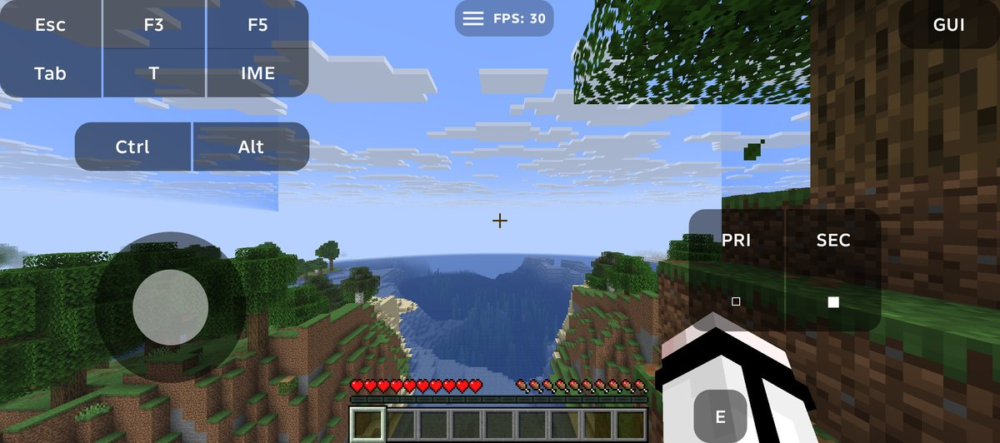
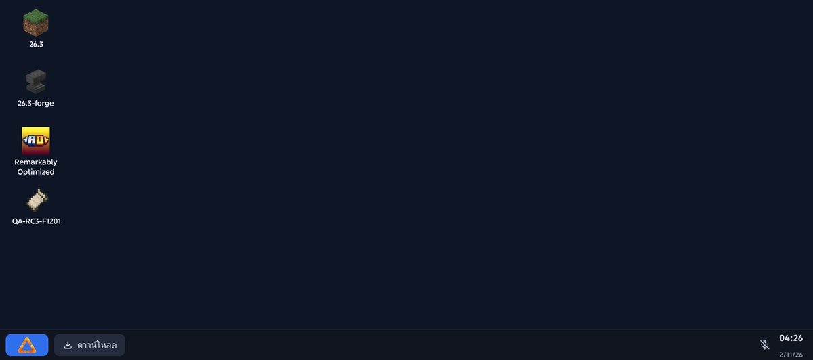
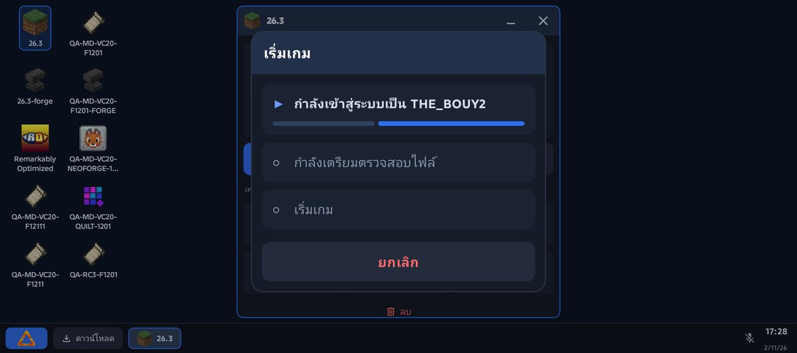
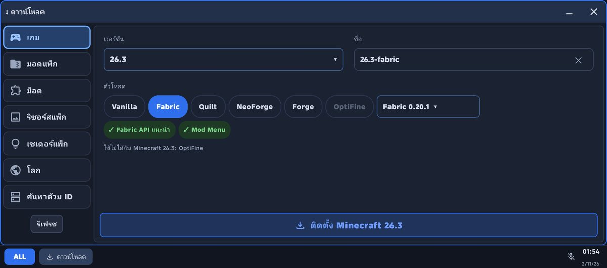
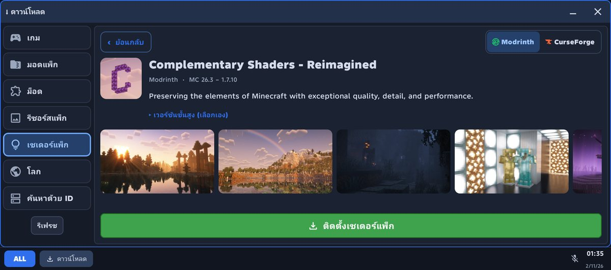
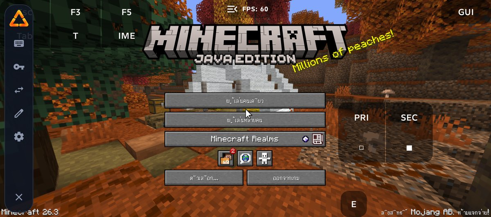
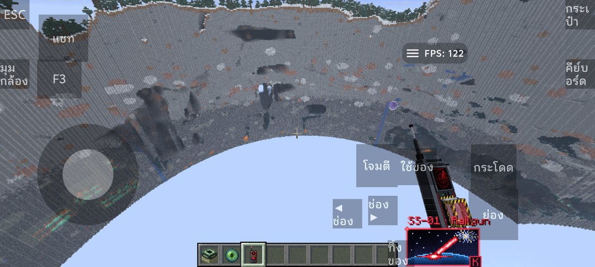

<div align="center">


# ALL Launcher

**在 Android 上以桌面風格啟動器遊玩 Minecraft: Java Edition**

[ภาษาไทย](README.md) · [English](README_EN_US.md) · 繁體中文



</div>

> [!IMPORTANT]
> ALL Launcher 是 MovTery 與貢獻者所開發的 [Zalith Launcher 2](https://github.com/ZalithLauncher/ZalithLauncher2) 的**非官方修改版本（Unofficial Modified Version）**，並非由 Zalith Launcher 開發者、Mojang 或 Microsoft 製作或認可。

## 這是什麼

一款在手機上執行 **Minecraft: Java Edition** 的 Android 應用程式，採用桌面風格介面（**ALL Desktop**：每個遊戲實例都是桌面圖示，以視窗開啟，並有工作列與開始選單）。可安裝 Vanilla、Fabric、Quilt、NeoForge 與 Forge，下載模組、模組包、資源包、光影包與世界，並以 **Mod Doctor** 檢查已安裝的模組。與 Zalith Launcher 2 相同，以 [PojavLauncher](https://github.com/PojavLauncherTeam/PojavLauncher) 作為啟動核心。

## 1.0.0 重點

- 已在實機（TECNO、iQOO）上測試 Minecraft 26.3、1.21.11 與 1.20.1
- 覆蓋安裝 Beta 3 時保留帳號、實例、模組、世界與設定
- `ALLCompatAgent`（ALL 自行開發，GPL）讓含 Sodium 的模組包能在 Android 上啟動
- `MioLibPatcher`、`forge_installer` 與 `nide8auth` 不再內含於 APK，首次使用時從發布者下載
- 簡約的遊戲安裝頁、完整顯示的光影包預覽圖、全面使用 ALL 標誌
- 帳號：Microsoft 與離線帳號（預設隱藏）；authlib-injector 與 Nide8 於 Classic 模式使用
- 渲染器：MobileGlues（1.17 以上自動選用）、GL4ES / NG-GL4ES、Kopper Zink、Freedreno、Panfrost、VirGL；內建 Java 8 / 17 / 21 / 25

## 截圖

| | |
|---|---|
|  |  |
|  |  |
|  |  |

## 下載

[**最新版本（1.0.0）**](https://github.com/TheBouy3224/ALL-Launcher/releases/latest)：`ALLLauncher-1.0.0-arm64-v8a.apk`（安裝此檔）、`ALLLauncher-1.0.0-SOURCE.zip`（完整原始碼）、`ALLLauncher-1.0.0-OPENJDK-SOURCES.zip`（內建執行環境的 OpenJDK 原始碼）、`SHA256SUMS.txt`。

Android 8.0 以上（API 26+），**僅支援 ARM64**。套件 `com.all.launcher.app`，versionCode 21。

## 注意事項

- Microsoft 登入目前使用暫時的備用 client id，現在可用但 Microsoft 可能封鎖（[詳情](PUBLIC-RELEASE-REQUIREMENTS.md)）。
- 部分輔助檔案會在首次啟動遊戲時下載，第一次遊玩請保持連線。
- 完整清單：[`KNOWN_ISSUES.md`](KNOWN_ISSUES.md)。

## 構建方式

JDK 25（21 以上可用；17 會使 release lint 任務崩潰）、Android SDK 37 minor 2、NDK 25.2.9519653、Gradle 9.5.0 wrapper。

```bash
git clone https://github.com/TheBouy3224/ALL-Launcher.git
cd ALL-Launcher
./gradlew :ZalithLauncher:assembleDebug -Darch=arm64
```

Linux 設定：[`BUILDING-UBUNTU.md`](BUILDING-UBUNTU.md)。發布用簽名金鑰不在此儲存庫中。

## 上游專案

ALL Launcher 基於 Zalith Launcher 2（[儲存庫](https://github.com/ZalithLauncher/ZalithLauncher2)、[Weblate](https://hosted.weblate.org/projects/zalithlauncher2)、[贊助 MovTery](https://afdian.com/a/MovTery)）。ALL Launcher 的問題請回報至[本儲存庫](https://github.com/TheBouy3224/ALL-Launcher/issues)，請勿回報給 Zalith Launcher 開發者。以下授權條款與開源專案列表保留自 Zalith Launcher 2。

## 📜 License

本專案程式碼遵循 **[GPL-3.0 license](LICENSE)** 開源協議。

### 附加條款（依據 GPLv3 開源授權條款第七條）

1. 當你分發本程式的修改版本時，必須以合理方式修改該程式的名稱或版本號，以區別於原始版本。（依據 [GPLv3, 7(c)](https://github.com/ZalithLauncher/ZalithLauncher2/blob/969827b/LICENSE#L372-L374)）
    - 修改版本 **不得在名稱中包含原程式名稱「ZalithLauncher」或其縮寫「ZL」，亦不得使用與官方名稱相近、可能造成混淆的名稱**。
    - 所有修改版本 **必須在程式啟動畫面或主介面中以明顯方式標示其為「非官方修改版」**。
    - 程式的應用名稱可於 [gradle.properties](./ZalithLauncher/gradle.properties) 中進行修改。

2. 你不得移除本程式所顯示的版權聲明。（依據 [GPLv3, 7(b)](https://github.com/ZalithLauncher/ZalithLauncher2/blob/969827b/LICENSE#L368-L370)）

## 引用開源專案
  
本軟體使用以下開源函式庫:

| Library                               | Copyright                                                                                                     | License              | Official Link                                                                     |
|---------------------------------------|---------------------------------------------------------------------------------------------------------------|----------------------|-----------------------------------------------------------------------------------|
| androidx-appcompat                    | Copyright © The Android Open Source Project                                                                   | Apache 2.0           | [链接↗](https://developer.android.com/jetpack/androidx/releases/appcompat)         |
| androidx-constraintlayout-compose     | Copyright © The Android Open Source Project                                                                   | Apache 2.0           | [链接↗](https://developer.android.com/develop/ui/compose/layouts/constraintlayout) |
| androidx-webkit                       | Copyright © The Android Open Source Project                                                                   | Apache 2.0           | [链接↗](https://developer.android.com/jetpack/androidx/releases/webkit)            |
| ANGLE                                 | Copyright 2018 The ANGLE Project Authors                                                                      | BSD 3-Clause License | [链接↗](http://angleproject.org/)                                                  |
| Apache Commons Codec                  | -                                                                                                             | Apache 2.0           | [链接↗](https://commons.apache.org/proper/commons-codec)                           |
| Apache Commons Compress               | -                                                                                                             | Apache 2.0           | [链接↗](https://commons.apache.org/proper/commons-compress)                        |
| Apache Commons IO                     | -                                                                                                             | Apache 2.0           | [链接↗](https://commons.apache.org/proper/commons-io)                              |
| ByteHook                              | Copyright © 2020-2024 ByteDance, Inc.                                                                         | MIT License          | [链接↗](https://github.com/bytedance/bhook)                                        |
| BuildKeys                             | Copyright © 2026 MovTery                                                                                      | Aoache 2.0           | [链接↗](https://github.com/MovTery/BuildKeys)                                      |
| Coil Compose                          | Copyright © 2025 Coil Contributors                                                                            | Apache 2.0           | [链接↗](https://github.com/coil-kt/coil)                                           |
| Coil Gifs                             | Copyright © 2025 Coil Contributors                                                                            | Apache 2.0           | [链接↗](https://github.com/coil-kt/coil)                                           |
| Coil SVG                              | Copyright © 2025 Coil Contributors                                                                            | Apache 2.0           | [链接↗](https://github.com/coil-kt/coil)                                           |
| Fishnet                               | Copyright © 2025 Kyant                                                                                        | Apache 2.0           | [链接↗](https://github.com/Kyant0/Fishnet)                                         |
| gl4es_extra_extra                     | Copyright © 2016-2018 Sebastien Chevalier; Copyright (c) 2013-2016 Ryan Hileman                               | MIT License          | [链接↗](https://github.com/PojavLauncherTeam/gl4es_extra_extra)                    |
| Gson                                  | Copyright © 2008 Google Inc.                                                                                  | Apache 2.0           | [链接↗](https://github.com/google/gson)                                            |
| kotlinx.coroutines                    | Copyright © 2000-2020 JetBrains s.r.o.                                                                        | Apache 2.0           | [链接↗](https://github.com/Kotlin/kotlinx.coroutines)                              |
| ktor-client-content-negotiation       | Copyright © 2000-2023 JetBrains s.r.o.                                                                        | Apache 2.0           | [链接↗](https://ktor.io)                                                           |
| ktor-client-core                      | Copyright © 2000-2023 JetBrains s.r.o.                                                                        | Apache 2.0           | [链接↗](https://ktor.io)                                                           |
| ktor-client-okhttp                    | Copyright © 2000-2023 JetBrains s.r.o.                                                                        | Apache 2.0           | [链接↗](https://ktor.io)                                                           |
| ktor-http                             | Copyright © 2000-2023 JetBrains s.r.o.                                                                        | Apache 2.0           | [链接↗](https://ktor.io)                                                           |
| ktor-serialization-kotlinx-json       | Copyright © 2000-2023 JetBrains s.r.o.                                                                        | Apache 2.0           | [链接↗](https://ktor.io)                                                           |
| LWJGL - Lightweight Java Game Library | Copyright © 2012-present Lightweight Java Game Library All rights reserved.                                   | BSD 3-Clause License | [链接↗](https://github.com/LWJGL/lwjgl3)                                           |
| material-color-utilities              | Copyright 2021 Google LLC                                                                                     | Apache 2.0           | [链接↗](https://github.com/material-foundation/material-color-utilities)           |
| Maven Artifact                        | Copyright © The Apache Software Foundation                                                                    | Apache 2.0           | [链接↗](https://github.com/apache/maven/tree/maven-3.9.9/maven-artifact)           |
| Media3                                | Copyright © The Android Open Source Project                                                                   | Apache 2.0           | [链接↗](https://developer.android.com/jetpack/androidx/releases/media3)            |
| Mesa                                  | Copyright © The Mesa Authors                                                                                  | MIT License          | [链接↗](https://mesa3d.org/)                                                       |
| MMKV                                  | Copyright © 2018 THL A29 Limited, a Tencent company.                                                          | BSD 3-Clause License | [链接↗](https://github.com/Tencent/MMKV)                                           |
| Navigation 3                          | Copyright © The Android Open Source Project                                                                   | Apache 2.0           | [链接↗](https://developer.android.com/jetpack/androidx/releases/navigation3)       |
| NG-GL4ES                              | Copyright © 2016-2018 Sebastien Chevalier; Copyright © 2013-2016 Ryan Hileman; Copyright (c) 2025-2026 BZLZHH | MIT License          | [链接↗](https://github.com/BZLZHH/NG-GL4ES)                                        |
| OkHttp                                | Copyright © 2019 Square, Inc.                                                                                 | Apache 2.0           | [链接↗](https://github.com/square/okhttp)                                          |
| Okio                                  | Copyright © 2013 Square, Inc.                                                                                 | Apache 2.0           | [链接↗](https://square.github.io/okio/)                                            |
| OpenNBT                               | Copyright © 2013-2021 Steveice10.                                                                             | MIT License          | [链接↗](https://github.com/GeyserMC/OpenNBT)                                       |
| Process Phoenix                       | Copyright © 2015 Jake Wharton                                                                                 | Apache 2.0           | [链接↗](https://github.com/JakeWharton/ProcessPhoenix)                             |
| proxy-client-android                  | -                                                                                                             | LGPL-3.0 License     | [链接↗](https://github.com/TouchController/TouchController)                        |
| Reorderable                           | Copyright © 2023 Calvin Liang                                                                                 | Apache 2.0           | [链接↗](https://github.com/Calvin-LL/Reorderable)                                  |
| sdl2-compat                           | Copyright (C) 2026 Sam Lantinga <slouken@libsdl.org>                                                          | Zlib License         | [链接↗](https://github.com/libsdl-org/sdl2-compat)                                 |
| SDL3                                  | Copyright (C) 1997-2026 Sam Lantinga <slouken@libsdl.org>                                                     | Zlib License         | [链接↗](https://github.com/libsdl-org/SDL)                                         |
| skinview3d                            | Copyright © 2014-2018 Kent Rasmussen; Copyright © 2017-2022 Haowei Wen, Sean Boult and contributors           | MIT License          | [链接↗](https://github.com/bs-community/skinview3d)                                |
| sora-editor                           | Copyright (C) 2020-2026  Rosemoe                                                                              | LGPL-2.1 License     | [链接↗](https://github.com/Rosemoe/sora-editor)                                    |
| StringFog                             | Copyright © 2016-2023, Megatron King                                                                          | Apache 2.0           | [链接↗](https://github.com/MegatronKing/StringFog)                                 |
| tm4e (TextMate for Eclipse)           | Copyright © Eclipse Foundation                                                                                | EPL-2.0 License      | [链接↗](https://github.com/eclipse-tm4e/tm4e)                                      |
| XZ for Java                           | Copyright © The XZ for Java authors and contributors                                                          | 0BSD License         | [链接↗](https://tukaani.org/xz/java.html)                                          |